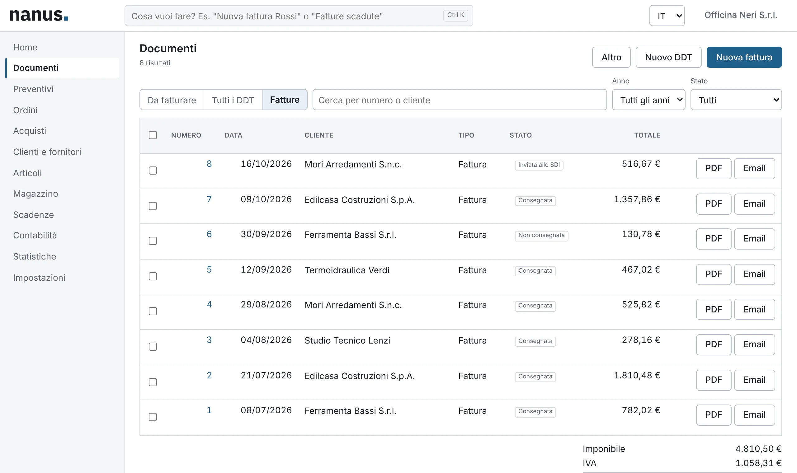
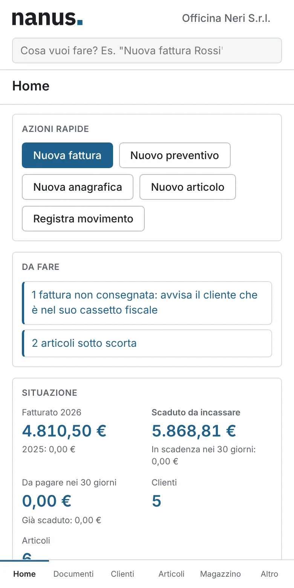

<div align="center">

<a href="https://nanus.it">
  <picture>
    <source media="(prefers-color-scheme: dark)" srcset=".github/assets/logo-negativo.svg">
    
  </picture>
</a>

### Il gestionale italiano per la fatturazione elettronica

Fatture elettroniche, preventivi, DDT, ordini, magazzino, scadenze e prima nota.<br>
Nel browser, sullo smartphone e sul computer, anche senza connessione.

[](https://github.com/dioxvi/nanus-download/releases/latest)
[](https://github.com/dioxvi/nanus-download/releases/latest)
[](https://github.com/dioxvi/nanus-download/releases)


<br>

[](https://github.com/dioxvi/nanus-download/releases/latest)
&nbsp;
[](https://app.nanus.it)
&nbsp;
[](https://nanus.it)

[Italiano](#scarica) · [English](#english)

</div>

<br>

<p align="center">
  
</p>

---

## Scarica

Questo repository contiene **solo gli installer** dell'app desktop di Nanus. Ogni versione è nella sezione
[Releases](https://github.com/dioxvi/nanus-download/releases), con le note di rilascio in italiano e in inglese.

| Sistema | File da scaricare | Requisiti |
|---|---|---|
| **Windows** | `Nanus_X.Y.Z_x64-setup.exe` (consigliato)<br>`Nanus_X.Y.Z_x64_en-US.msi` per le reti aziendali | Windows 10 o 11, 64 bit |
| **Linux** | `Nanus_X.Y.Z_amd64.AppImage` (qualsiasi distribuzione)<br>`Nanus_X.Y.Z_amd64.deb` per Debian e Ubuntu<br>`Nanus-X.Y.Z-1.x86_64.rpm` per Fedora e openSUSE | 64 bit (x86_64) |
| **macOS** | In arrivo: nel frattempo usa Nanus [nel browser](https://app.nanus.it) | macOS 11 o successivo |

**[⬇ Scarica l'ultima versione](https://github.com/dioxvi/nanus-download/releases/latest)** · oppure dalla pagina
**[nanus.it/download](https://nanus.it/download)**, che mostra il file giusto per il tuo computer con la sua impronta SHA-256.

> Nel browser e sullo smartphone non c'è nulla da installare: basta aprire **[app.nanus.it](https://app.nanus.it)**.

## Installazione

<details open>
<summary><b>Windows</b></summary>

1. Scarica `Nanus_X.Y.Z_x64-setup.exe` e aprilo.
2. Segui la procedura: l'installer è **firmato digitalmente da Maingage S.r.l.**, quindi Windows mostra il nome
   dell'editore.
3. Apri Nanus dal menu Start.

Il pacchetto `.msi` serve a chi distribuisce il programma su più computer di un'azienda (Criteri di gruppo,
Intune e simili).
</details>

<details>
<summary><b>Linux</b></summary>

**AppImage**, senza installare nulla:

```bash
chmod +x Nanus_*_amd64.AppImage
./Nanus_*_amd64.AppImage
```

**Debian e Ubuntu**:

```bash
sudo apt install ./Nanus_*_amd64.deb
```

**Fedora e openSUSE**:

```bash
sudo dnf install ./Nanus-*.x86_64.rpm      # Fedora
sudo zypper install ./Nanus-*.x86_64.rpm   # openSUSE
```
</details>

## Aggiornamenti automatici

L'app si aggiorna da sola. All'avvio, e poi ogni 6 ore se resta aperta, controlla se c'è una versione nuova,
la scarica mentre lavori e **ne verifica la firma digitale** prima di tenerla pronta. L'aggiornamento si installa
alla chiusura, oppure subito con **Aggiorna ora** nella Home. I tuoi dati restano dove sono.

Con i pacchetti `.msi`, `.deb` e `.rpm` l'aggiornamento chiede la password di amministratore: è normale.

## Verifica il file scaricato

Ogni versione ha il file `SHA256SUMS.txt` con l'impronta SHA-256 di tutti gli installer. Calcola quella del file
scaricato e confrontala:

```powershell
# Windows (PowerShell)
Get-FileHash .\Nanus_X.Y.Z_x64-setup.exe -Algorithm SHA256
```

```bash
# Linux e macOS (Terminale), nella cartella dei file scaricati
sha256sum --ignore-missing -c SHA256SUMS.txt
```

## Cosa fa Nanus

<table>
<tr>
<td width="62%" valign="top">

- **Fattura elettronica** verso privati, aziende e Pubblica Amministrazione, con invio e ricezione dallo SDI
  e i controlli fiscali prima dell'invio.
- **Preventivi, ordini, DDT** e fatture che nascono l'una dall'altra, con stampa e invio per email.
- **Magazzino** con giacenze, depositi, varianti, lotti e matricole.
- **Scadenze**, incassi, pagamenti, RiBa e SDD; **prima nota** e registri IVA.
- **Agenti** e provvigioni, **statistiche** e più aziende nello stesso programma.
- **Passa a Nanus** da Easyfatt o Invoicex portando con te l'archivio, e scarica tutti i tuoi dati quando vuoi.

Tutte le funzioni: [nanus.it/funzionalita](https://nanus.it/funzionalita) ·
Novità di ogni versione: [nanus.it/novita](https://nanus.it/novita)

</td>
<td width="38%" align="center" valign="top">

</td>
</tr>
</table>

## I tuoi dati

- Sull'app desktop i dati stanno **in una cartella del tuo computer** e Nanus funziona anche senza connessione.
- Ogni giorno Nanus fa da solo una copia dei dati e conserva le ultime 14: le ripristini da
  Impostazioni → Backup e ripristino.
- Con un piano a pagamento l'app desktop può anche lavorare **collegata al cloud**, con gli stessi dati che vedi
  nel browser.

## Piani

Il piano **Free** è gratuito sull'app desktop, fino a 100 documenti l'anno, con gli stessi controlli fiscali dei
piani a pagamento. Cloud, invio automatico allo SDI, magazzino e più persone al lavoro sono nei piani
Essenziale, Pro e Business. Dettagli e prezzi: [nanus.it/prezzi](https://nanus.it/prezzi).

## Aiuto e contatti

- 📖 Manuali: [nanus.it/manuali](https://nanus.it/manuali)
- ✉️ Assistenza: [info@nanus.it](mailto:info@nanus.it), oppure dall'app da Impostazioni → Assistenza e segnalazioni
- 🔒 Privacy: [privacy@nanus.it](mailto:privacy@nanus.it) · [Informativa](https://nanus.it/privacy)

Per segnalare un problema scrivici all'indirizzo di assistenza: in questo repository le issue non sono seguite.

---

<a id="english"></a>

## English

**Nanus** is Italian e-invoicing and business management software: e-invoices through the SDI, quotes, orders,
delivery notes, inventory, due dates and accounting, in the browser, on your phone and on your computer, also
offline. This repository only hosts the **desktop app installers**.

| System | File | Requirements |
|---|---|---|
| **Windows** | `Nanus_X.Y.Z_x64-setup.exe` (recommended), or `.msi` for managed networks | Windows 10 or 11, 64-bit |
| **Linux** | `.AppImage` (any distribution), `.deb` (Debian, Ubuntu), `.rpm` (Fedora, openSUSE) | 64-bit (x86_64) |
| **macOS** | Coming soon: meanwhile use Nanus [in your browser](https://app.nanus.it) | macOS 11 or later |

**[⬇ Download the latest version](https://github.com/dioxvi/nanus-download/releases/latest)** or go to
**[nanus.it/en/download](https://nanus.it/en/download)**.

- **Signed:** the Windows installer is digitally signed by Maingage S.r.l.; every update is signed and verified
  by the app before it is installed.
- **Automatic updates:** the app checks at start-up and every 6 hours, downloads in the background and installs
  when you close it, or right away with **Update now**.
- **Checksums:** every release includes `SHA256SUMS.txt`.
- **Your data** stays in a folder on your computer, with a daily backup (last 14 kept).
- **Free plan:** up to 100 documents a year on the desktop app. Plans: [nanus.it/en/pricing](https://nanus.it/en/pricing).
- **Help:** [manuals](https://nanus.it/en/manuals) · [info@nanus.it](mailto:info@nanus.it)

---

<div align="center">
<sub>
Nanus è un prodotto di <b>Maingage S.r.l.</b> · Via Grotte 42, 70013 Castellana Grotte (BA) · P.IVA 08372160724<br>
I nomi di altri programmi citati appartengono ai rispettivi titolari e servono solo a indicare da dove si importano i dati.<br>
© Maingage S.r.l. Tutti i diritti riservati. Il codice sorgente di Nanus non è pubblico.
</sub>
</div>
